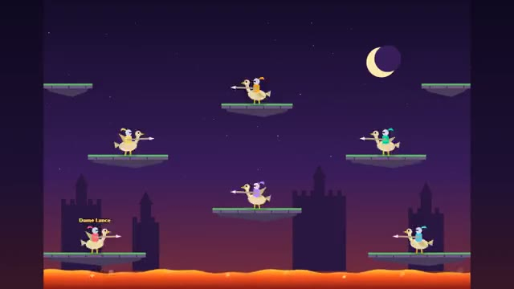

# Sky Joust

Flap higher. Lance lower knights. Grab their eggs. A multiplayer starter game from [Multiplayer Agent](https://multiplayeragent.com): 2D, versus, 2–6 players, with bots that fill empty seats.

## How it plays

Flap to fly your knight on its giant bird. When two knights crash, the higher lance wins and the loser drops an egg: grab it before it hatches or they're back. Stay out of the lava and its grabbing hand. Last knight flying wins the round; first to 5 rounds wins.

**Controls:** Arrows or A/D to steer, Space, Z or Up to flap; on touch, the arrow buttons and Flap.

## Make it yours in the Game Builder

Open the [Game Builder](https://multiplayeragent.com), choose **Start from a starter game** and pick Sky Joust. It opens as version 1 in your studio, ready to play and publish. Then ask for changes, for example:

- Add a pterodactyl that hunts whoever is winning
- Make the lava rise a little every round
- Let me pick my bird's color before the match

## Run it yourself

1. Get a free publishable key (`pk_…`) at [multiplayeragent.com](https://multiplayeragent.com).
2. In `index.html`, put it in place of `pk_REPLACE_ME` in the `MP_CONNECT` block.
3. Open `index.html` in a browser. No build step and no server needed.

Without a key it still runs, offline against bots.

## How it is built

- One `index.html`. The comment at the top of the script maps the code and explains the multiplayer.
- **Leaderboard:** Matches won, shown on the results card.
- **Bots:** Bots fill the empty seats, and someone who joins takes a bot's seat next round.
- **Host-run rounds:** The host's browser keeps the rounds and the score; if it leaves, the next player takes over.
- **Live sync:** Every knight flies for everyone at once; whoever ends up lower calls their own fall.
- `?attract` runs it offline with bots only. The preview video is recorded from it.

## License

MIT.
